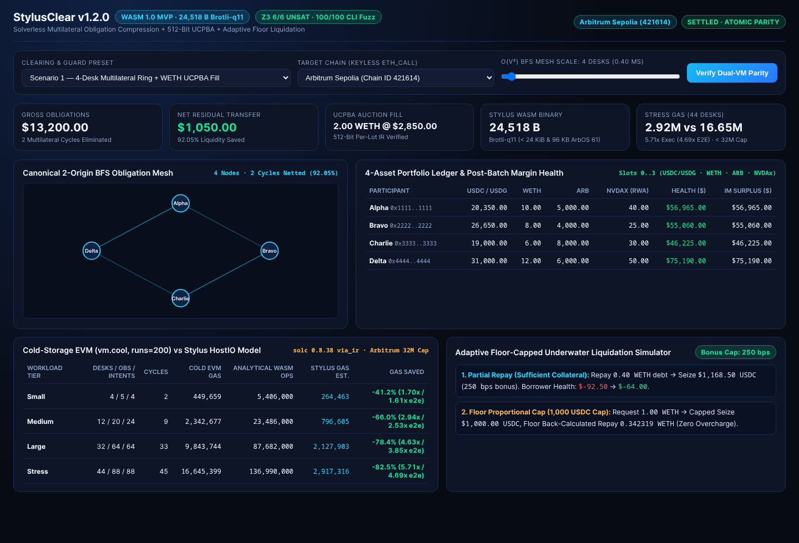
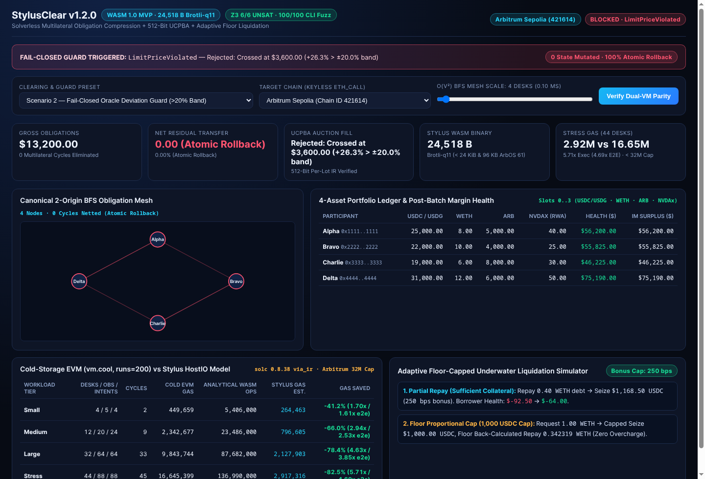

# StylusClear v1.2.0 — Solverless Multilateral Clearing & Margin Engine on Arbitrum Stylus

**StylusClear** is a deterministic, solverless multilateral obligation-compression and batch-clearing engine written in `no_std` Rust for **Arbitrum Stylus** (compiling to zero-patch **WASM 1.0 MVP**, `24,518 B` Brotli-q11 — `54 B` below the `24,576 B` legacy cap incl. 4-byte Stylus header and `73,782 B` below the `ArbOS 61` `96 KB` cap), paired with a bit-exact Solidity reference engine (`SolidityClearingBenchmark.sol`, `24,514 B` runtime under `optimizer_runs = 200`), **6/6 Z3 SMT formal proofs** (`PROVED_UNSAT`), **100/100 cross-binary EIP-712 Hypothesis differential fuzzing** (`cli_replay_cross_checked: true`), and a dual-chain keyless Web Workbench targeting **Arbitrum Sepolia (`421614`)** and **Robinhood Chain Testnet (`46630`)**.

## Live Deployment Status (Zero-Mock Transparency)

| Target Network | Chain ID | Status | Atomic Factory / Stylus / Solidity Addresses | Verification Script |
| :--- | :---: | :--- | :--- | :--- |
| **Arbitrum Sepolia** | `421614` | `Pending Local Broadcast (Zero-Mock)` | Auto-populated in [`deployments/arbitrum-sepolia.json`](deployments/arbitrum-sepolia.json) by `scripts/deploy-sepolia.sh` | `2-DEPLOY-AND-PUSH.cmd` |
| **Robinhood Chain Testnet** | `46630` | `Pending Local Broadcast (Zero-Mock)` | Auto-populated in [`deployments/robinhood-testnet.json`](deployments/robinhood-testnet.json) by `scripts/deploy-robinhood-testnet.sh` | `2-DEPLOY-AND-PUSH.cmd` |

> **Honesty Guarantee**: Repository manifests intentionally contain `null` addresses until broadcast from a funded local testnet wallet. Zero fabricated addresses or mock hashes are committed.

## Key Architecture & Technical Highlights

1. **Zero-Patch WASM 1.0 MVP (`24,518 B` Brotli-q11)**: Built with `rustc` + official Binaryen `wasm-opt` (`--llvm-memory-copy-fill-lowering --signext-lowering -Oz --code-folding --coalesce-locals-learning`) from `artifacts/clearing_stylus.wasm` (`65,635 B` raw, `SHA-256: c2f3244ddeca5c54e9ac47be27caabd38f50d7cfc6b3af19457db98f5f4588b3`, **0 float / 0 post-MVP opcodes**).
2. **O(V²) 2-Origin BFS Cycle Compression**: Eliminates multilateral obligation rings (`2/9/33/45` cycles across Small/Medium/Large/Stress workloads) in canonical address order, reducing institutional settlement liquidity needs by up to **92.05%** (`$13,200 → $1,050` in Scenario 1).
3. **512-Bit Uniform Clearing Price Batch Auction (UCPBA)**: Exact 512-bit intermediate math (`FullMath512.sol` & `clearing-core/math.rs`) with directional rounding (buyers pay `ceil`, sellers receive `floor`, bounded `0–1 wei` rounding dust routed to fee vault) and strict ±20% oracle deviation circuit breaker.
4. **Adaptive Floor Liquidation & Zero-Deadlock Dust Closure**: Adaptive bonus `min(mm_bps / 2, 250)` (with `mm_bps >= 2` enforced across Rust, Solidity, and Python), proportional two-step floor collateral cap, full-collateral & full-debt liquidation exemptions, sub-quantum dust confiscation during `absorbBadDebt` (preventing dust-collateral deadlocks), and `repaySubQuantumDebt()` for 6/8-decimal ERC-20 tokens.
5. **Strict CEI Atomic Factory & Hardened Dual-VM Parity**: `StylusAtomicFactory.sol` (`2,064 B`) atomically deploys, activates (`ArbWasm 0x71`, catching `ProgramUpToDate`), initializes, verifies `admin()` + `benchmarkSeedingEnabled()`, emits `EngineAtomicallyDeployed`, and refunds excess ETH under strict CEI. All 37 ABI methods and 19 custom errors enforce identical read-only reentrancy guards (`checkUnlocked` / `check_non_reentrant`), 64-byte return-data bomb protection, and compact 4 KB Solidity bitmap authentication.
6. **Formal Verification (Z3 + Cross-Binary CLI Fuzzing)**: `tools/formal/prove_invariants_z3.py` proves **6/6 non-trivial theorems `PROVED_UNSAT`** (T1 full-domain `haircut_c in [0, 9999]` Adaptive Bonus Zero-Deadlock, T2 Proportional Cap Bound, T3 UCPBA IR & Unaligned `<1 wei` Dust Bound, T4 Full-Domain U512 FullMath Overflow & Carry Guard, T5 4-Step Multi-Decimal Vault Transition Solvency, T6 BitVec(256) Sub-Quantum Debt Exit) + **100/100 EIP-712 Hypothesis differential cases** verified bit-for-bit against the compiled Rust `clearing-cli` binary (`docs/security/z3-formal-proofs.json`).

## Cold-Storage Gas & Stylus Ink Benchmarks (`v1.2.0`)

Calibrated with `solc 0.8.38` (`via_ir = true`, `optimizer_runs = 200`, `vm.cool()` cold slots, 4 KB compact bitmap) vs host-verified Rust `clearing-cli` replay + full EIP-2929 HostIO pricing (`20,000`-gas cold `0 -> non-zero` nonce SSTOREs, `5,000`-gas warm SSTOREs, quadratic `memory_grow`, `10,000 ink = 1 EVM gas`; full report in [`docs/benchmarks/gas-comparison-report.md`](docs/benchmarks/gas-comparison-report.md)):

| Tier | Desks | Obligations | Cycles | Intents | Solidity Cold EVM Gas | Stylus Total Gas (Est.) | Net Gas Saved (`exec` / `e2e`) |
| :--- | :---: | :---: | :---: | :---: | :---: | :---: | :---: |
| `Small` | 4 | 5 | 2 | 4 | `449,659` | `264,463` | **41.2% (`1.70x` exec / `1.61x` e2e)** |
| `Medium` | 12 | 20 | 9 | 24 | `2,342,677` | `796,605` | **66.0% (`2.94x` exec / `2.53x` e2e)** |
| `Large` | 32 | 64 | 33 | 64 | `9,843,744` | `2,127,903` | **78.4% (`4.63x` exec / `3.85x` e2e)** |
| `Stress` | 44 | 88 | 45 | 88 | `16,645,399` | `2,917,316` | **82.5% (`5.71x` exec / `4.69x` e2e)** |


*Note: All tiers remain strictly below Arbitrum's `32,000,000` single-block gas cap. Both execution-frame (`exec`) and L2-calldata-inclusive (`e2e`) speedups are disclosed. Offline analytical HostIO figures are replaced by live `eth_estimateGas` / `evm_ink_left()` readings upon Arbitrum Sepolia deployment.*

## 5-Stage Judge Verification (`< 60s`)

```bash
bash scripts/verify-judge-60s.sh
```

Runs all 5 deterministic verification stages in under 60 seconds:
1. Strict architecture, SHA-256 WASM/initcode/SHA256SUMS parity & zero-leak gate (`tools/archcheck/check.py . --strict`, `wasm-opt --mvp-features`, `generate-benchmarks.py --verify-only`)
2. Rust workspace tests (`9/9` passing) & `clippy -D warnings`
3. Foundry differential & 2×256 fuzz suite (`18/18` passing, `SolidityClearingBenchmark` `24,514 B`)
4. Z3 formal SMT proofs (`6/6 UNSAT`) + Python Seam S1/S2/S4 (`10/10` passing, incl. `clearing-cli` golden differential)
5. Dual-chain Web Workbench Seam S3 (`37-method ABI`, real `settleBatch` `0xcf36836c` calldata verification, `421614` & `46630`) + Headless Chromium 3-viewport E2E (`1440x980`, `768x1024`, `390x844`)

## Interactive Web Workbench & Visual Preview




Open locally via:
```bash
python3 -m http.server 8080 --directory web
```

## Minimal Local Deployment (Windows 11 + WSL2 One-Click)

1. Double-click `1-UNPACK-TO-C.cmd` (or run `UNPACK-TO-C-DRIVE.ps1 -TargetDir "C:\stylusclear"`) to unpack to a clean ASCII path.
2. Double-click `C:\stylusclear\2-DEPLOY-AND-PUSH.cmd` (prompts for `PRIVATE_KEY` via masked `Read-Host -AsSecureString` with zero PowerShell history leakage, deploys via cloud-precompiled `artifacts/contracts-compiled.json` & `artifacts/clearing_stylus.initcode.hex` with idempotent checkpoint resume, and backfills live gas telemetry).
